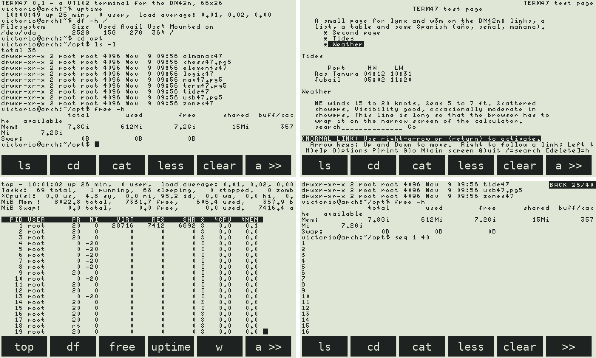
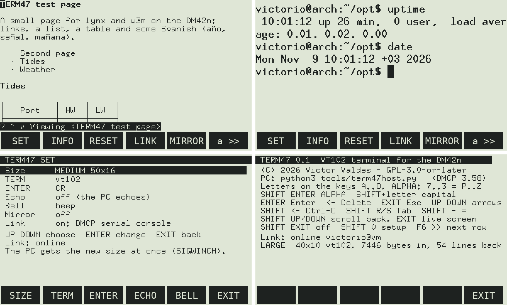

# TERM47 — a VT102 text terminal for the DM42n

**TERM47.pg5** is a native DMCP5 program in C for the SwissMicros **DM42n**. It turns the calculator into a text
terminal, like the old Unix VT100 / VT102 terminals: it does no calculation. The screen shows what the PC's shell
sends, and the keys go to it. Run `bash`, `top`, `less`, `vi`, `ssh` to another machine, or browse the web with
**lynx** and **w3m**, on the calculator's screen.

Part of the "47" family of projects (almanac47, chess47, nav47, tide47 …). It is built like
[Chess 47](https://github.com/valdesvj/chess47.pg5) and [NAV47](https://github.com/valdesvj/nav47.pg5): the same
DMCP5 base, the soft-key bar (F1–F6, `>>` for the next row), the PC simulator, and DMCP5 3.58's serial console
over the USB cable.





*(Simulator pictures, with a real bash, lynx, top and w3m on the other end of the link. The menu bar's font stands
in for the DMCP one.)*

## How it works

```
DM42n (TERM47.pg5)  ⇄  USB cable, DMCP5 3.58 serial console  ⇄  /dev/ttyACM0  ⇄  tools/term47host.py  ⇄  bash, ssh, lynx, w3m ...
```

* The calculator is the screen and the keyboard. It understands the VT102 / ANSI escape sequences that full-screen
  programs use: cursor moves, scrolling regions, insert and delete line, inverse, bold and underline, the
  line-drawing characters, the alternate screen, and UTF-8 (Spanish ñ and accents, box drawing).
* `tools/term47host.py` runs on the PC. It starts your shell in a pseudo-terminal **of the calculator's size**,
  with the TERM type you chose. When you change the size on the calculator, the shell gets it at once (SIGWINCH),
  so lynx, w3m, less and top fit the screen.
* "Remote": run `ssh` in the shell, or start the host with `--cmd "ssh myserver"`. The PC is the gateway.
* The session stays when the cable is pulled or the calculator goes off. When the calculator comes back, the
  screen is drawn again.

## Install on the DM42n

1. **Back up the calculator disk first** (connect USB, copy everything).
2. Copy `release/TERM47.pg5` to the root of the calculator's USB disk.
   Also keep the current `DM42-x.yy.pg5` from SwissMicros there, so you can go back.
3. Open the DMCP menu: **SETUP → System → Run DMCP**, or press **RESET while holding F1**.
4. Choose **Load program → TERM47.pg5**.

**TERM47 needs DMCP5 3.58** (the serial console, IFC 3.18): DMCP's loader refuses the program on an older DMCP.

To return to Free42: in TERM47 press **SHIFT 0 (SETUP) → System**, or use **RESET+F1**, then
**Load program → DM42-x.yy.pg5**.

## On the PC

```bash
cd ~/opt/term47.pg5
python3 tools/term47host.py                      # finds the DM42n, runs your $SHELL
python3 tools/term47host.py /dev/ttyACM1         # a given port
python3 tools/term47host.py --cmd "ssh ship"     # a remote machine instead of the local shell
python3 tools/term47host.py --png /tmp/dm42.png  # with MIRROR on: the calculator's screen as a PNG
```

On Linux you need access to the port: `sudo usermod -aG uucp $USER` (Arch) or `dialout` (Debian), then log in
again. Python 3 only; `--png` needs Pillow.

## Screen sizes (SET page)

| Size | Font | Characters | |
|---|---|---|---|
| TINY | 5×8 | **80 × 26** | a real 80 columns, small |
| SMALL | 5×8 in a 6×8 cell | **66 × 26** | the default |
| MEDIUM | 8×13 | **50 × 16** | comfortable for lynx and w3m |
| LARGE | 10×20 | **40 × 10** | easy to read at sea |

The terminal uses the 208 rows of pixels above the soft keys, as NAV47. The fonts are the X11 "misc-fixed" bitmap
fonts (public domain), with the VT100 line-drawing characters and Latin-1.

## Keys

| Key | What it sends |
|---|---|
| **Σ+ … TAN, x⇄y, +/−, E** | the letters **a … o** (always) |
| **7 8 9 ÷ / 4 5 6 × / 1 2 3** | NUM: `7 8 9 / 4 5 6 * 1 2 3`; ALPHA: the letters **p … z** |
| **− 0 . R/S +** | NUM: `- 0 . space +`; ALPHA: `- / . space _` |
| **SHIFT ENTER** | switch NUM / ALPHA (the F6 key shows `a >>` in ALPHA) |
| **SHIFT** + a letter key | the capital letter |
| **ENTER** | Enter (CR, or CR LF on the SET page) |
| **←** | Delete (backspace) |
| **EXIT** | Esc (vi, lynx). When scrolled back: back to the live screen |
| **▲ ▼** | the cursor keys (in the scrollback: one line) |
| **SHIFT ←** | Ctrl-C |
| **SHIFT R/S** | Tab (completion) |
| **SHIFT − / SHIFT . / SHIFT +** | `=` `,` `|` |
| **SHIFT ▲ ▼** | scroll back through 200 lines, a screen at a time |
| **F1 … F5** | the soft keys: commands (below). **SHIFT F1 … F5**: the second command of the key |
| **F6** `>>` | the next row of soft keys; **SHIFT F6** `<<` the previous one |
| **SHIFT EXIT** | power off (the settings are saved; the PC keeps the session) |
| **SHIFT 0** | setup: time/date, beep, USB disk, **System**, About |

### Soft keys

| Row | F1 | F2 | F3 | F4 | F5 |
|---|---|---|---|---|---|
| SHELL | `ls -la` | `cd ` | `cat ` | `less ` | `clear` |
| SYS | `top` | `df -h` | `free -h` | `uptime` | `w` |
| NET | `ping -c 4 ` | `ssh ` | `lynx ` | `w3m ` | `ip -br a` |
| CTRL | ^C | ^D | ^Z | Tab | CTRL (the next key as a control key) |
| EDIT | ← | → | Page Up | Page Down | ^R |
| SYM | `/` | `|` | `~` | `>` | `$` |
| SYM2 | `=` | `"` | `:` | `(` | `[` |
| TERM | **SET** | **INFO** | **RESET** | **LINK** | **MIRROR** |

A command that ends without Enter (`cd `, `cat `, `ssh ` …) waits for you to type the rest. With SHIFT, some keys
give a second command (`ls -lah`, `cd ~`, `who`, `ip r`, Home, End, `\`, `&`, `*`, `<`, `'` …).

The rows are in **`/TERM47/MENU.TXT`** on the calculator's disk. TERM47 writes it the first time; change it to your
own commands (the comments at the top of the file explain the format: `label|text|SHIFT label|SHIFT text`, `\r`
for Enter, `^C` for control keys, `{UP}` `{LEFT}` … for the cursor keys). The TERM row is built in.

### SET page (TERM row, F1)

| | |
|---|---|
| Size | TINY 80×26, SMALL 66×26, MEDIUM 50×16, LARGE 40×10 |
| TERM | vt102 (default), vt100, vt220, ansi, xterm-mono: the TERM of a new session |
| ENTER | CR or CR LF |
| Echo | local echo, for a PC that does not echo |
| Bell | beep, flash the screen, or off |
| Mirror | DMCP also streams the screen to the PC (`tools/dm42view.py`, or `term47host.py --png`) |
| Link | the serial console on / off |

The settings are kept in `/TERM47/TERM47.CFG`.

## The link

TERM47 uses **DMCP5 3.58's serial console** (SwissMicros' preliminary *DMCP5 Serial Console API*, IFC 3.18), as
Chess 47 and NAV47. Channel 2 carries text lines; the terminal's bytes travel escaped as printable ASCII
(`src/proto.h`). DMCP keeps 256 bytes for a channel, so the PC never has more than two lines of output (120
characters each) waiting on the calculator: the calculator counts the lines it has read and sends the count back.
In the simulator (polling every 10 ms) this moves about 8 KB of terminal output a second (`seq 1 10000` in 6 s),
much more than the 9600 baud (1 KB/s) of a real VT100. On the calculator the speed depends on DMCP's serial console.

## Build

Requirements: `arm-none-eabi-gcc` (Debian/Ubuntu: `apt install gcc-arm-none-eabi libnewlib-arm-none-eabi`; Arch:
`arm-none-eabi-gcc arm-none-eabi-newlib`), `make`, `python3`.

```bash
make            # -> build/TERM47.pg5
make test       # PC: the terminal (75 checks) and the link's escaping
make compare    # ls, top, less, vi, lynx, w3m, man through TERM47's terminal and pyte (pip install pyte),
                # at 66x26, 80x26, 50x16 and 40x10: the same screen, cell for cell
make sim        # the PC simulator; test/run_sim.py joins it to term47host.py and a real bash
make fonts      # src/fonts.h again from the X11 fonts (xfonts-base / xorg-fonts-misc, Pillow)
```

The simulator runs the real `main.c`, `vt.c` and `link.c` against a fake DMCP layer. Its serial console is a
pseudo-terminal with `tools/term47host.py` on the other end, and it keeps DMCP's 256-byte buffer, so the flow
control is tested for real:

```bash
make sim
python3 test/run_sim.py WAIT:1500 TYPE:"lynx index.html" ENTER WAIT:2500 SNAP:lynx   # -> build/simrun/lynx.png
```

## Files

| | |
|---|---|
| `src/main.c` | the screen, keys, soft keys, SET and INFO pages, the main loop |
| `src/vt.c` | the VT102 / ANSI terminal (plain C, tested on the PC) |
| `src/link.c`, `src/proto.c` | the line to the PC over the serial console, the escaping |
| `src/fonts.h` | the four fonts (generated by `tools/mkfont.py`) |
| `tools/term47host.py` | the PC side: the shell in a pseudo-terminal |
| `tools/dm42view.py`, `tools/dm42port.py` | the screen mirror (from Chess 47 / NAV47) |
| `test/` | the terminal tests, the comparison with pyte, the simulator |

## Not yet tested on the calculator

TERM47 is tested in the simulator, end to end with a real shell. On the DM42n itself, check:

* DMCP5 3.58's serial console is preliminary: the line limits and timing are from SwissMicros' data sheet.
* The speed of full-screen redraws on battery (80 MHz) and on USB power (160 MHz).
* The letters on the keys: TERM47 puts A … Z on the keys by rows (the table above); check it against your keyboard.

## License

GPL-3.0-or-later (see `LICENSE` and `NOTICE`). The DMCP5 SDK files are BSD-3 (`LICENSE.DMCP5_SDK`). The fonts are
the public-domain X11 misc-fixed fonts.

This project was written with the help of AI; see [AI_ASSISTANCE.md](AI_ASSISTANCE.md).

SwissMicros, DM42 and HP are trademarks of their owners. This project is not affiliated with or endorsed by them.
